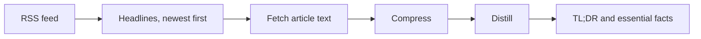

# PureNews

A news reader that strips articles down to the facts. Pick a feed, open a headline, and get a
one-paragraph TL;DR and a bullet list of the essential facts, without the hyperbole, speculation,
or spin.

Built in 2024 with Streamlit, LangChain, and OpenAI, to learn how to chain LLM calls and get
structured output back.

## How it works



1. **Feeds.** RSS feeds from AP, Reuters, NPR, The Atlantic, Vox, and Snopes, parsed with
   `feedparser` and sorted by date.
2. **Fetch.** Opening a headline downloads the article and pulls out the paragraph text.
3. **Compress.** A first, cheaper model call cuts the article down to as few tokens as possible
   without losing meaning, so the second call costs less.
4. **Distill.** GPT-4o breaks the compressed article into individual facts, drops opinion and
   speculation, and writes a short TL;DR. A LangChain `PydanticOutputParser` turns the answer
   into a typed object.
5. **Cache.** Fetched and distilled articles are cached for a day, so reopening one is instant
   and free.

## Usage

```bash
pip install -r requirements.txt
export OPENAI_API_KEY=sk-...      # Windows: set OPENAI_API_KEY=sk-...
streamlit run app.py
```

A dev container config is included if you'd rather run it in VS Code or Codespaces.

## What I learned

- Splitting the work in two (compress, then distill) made the expensive call cheaper and gave
  steadier results than one big prompt.
- Getting typed output back from a model is what made the result easy to display. This was
  before strict structured outputs were common, so it relied on format instructions and a parser.
- Fetching the article is the fragile part. Paywalls and page layouts break simple scraping
  long before the model has a problem.

## Status

A 2024 learning project, kept as is. [news-snap-api](https://github.com/DeanPhillipsOKC/news-snap-api)
was the start of a FastAPI back end for a fuller version.
